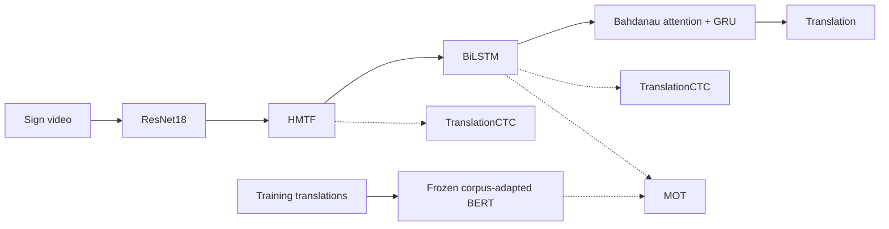

# TransAlign-SLT

### Complementary Temporal and Semantic Supervision for Gloss-Free Sign Language Translation

**Accepted at the Workshop on Sign Language Processing (WSLP 2026), co-located with EMNLP 2026**

**Authors:** Pallapu Mohan Krishna · Uppala Sanjay Kumar · M. K. Bhuyan · Debanga Raj Neog  
**Affiliation:** Indian Institute of Technology Guwahati, India  
**Contact:** [k.pallapu@iitg.ac.in](mailto:k.pallapu@iitg.ac.in) · [Research website](https://pallapumohankrishna.github.io/)

> **Code release status:** The source code is **not publicly available yet**. We are extending this research and plan to release the implementation and reproducibility materials later. This repository currently documents the accepted paper and its results. No release date is announced.

## Overview

**TransAlign-SLT** is a lightweight, **fully gloss-free sign language translation (SLT)** framework trained from paired sign videos and spoken-language translations. It does not require gloss annotations or pseudo-gloss supervision.

Learning from sentence-level translations alone makes it challenging to recover temporal structure and visual–language correspondence. TransAlign-SLT combines two complementary training signals:

- **TranslationCTC:** Auxiliary CTC supervision over translation tokens for coarse temporal-linguistic regularization.
- **Masked Entropic Optimal Transport (MOT):** Soft semantic correspondence between visual temporal features and word-level representations from a frozen, corpus-adapted BERT encoder.

The BERT/MOT semantic branch operates **only during training**. Inference uses a visual-temporal encoder and a compact attention-based GRU decoder, optionally with post-hoc TranslationCTC rescoring of completed hypotheses.

## Framework



Solid arrows indicate the main inference path. Dotted arrows show additional training supervision. TranslationCTC can also score completed beam-search hypotheses in an optional post-hoc reranking step.

### Method highlights

1. **Visual-temporal modeling:** ImageNet-initialized ResNet18 followed by Hierarchical Multi-scale Temporal Fusion (HMTF) and BiLSTM. HMTF adapts the architectural design of GPGN **without initializing from gloss-supervised GPGN weights**.
2. **Temporal guidance:** TranslationCTC at intermediate sequence representations, with the training coefficient decaying from **0.5 to 0.1**.
3. **Semantic guidance:** Training-set-only BERT corpus adaptation, subword-to-word pooling, and masked optimal transport between text and visual features.
4. **Translation:** Bahdanau attention and GRU decoder, with optional completed-hypothesis CTC reranking.
5. **Training objectives:** Translation cross-entropy, auxiliary TranslationCTC, distillation, and MOT.

## Main results

| Benchmark | Test BLEU-4 ↑ | Test ROUGE-L ↑ |
|:--|--:|--:|
| **PHOENIX14T** (German weather forecast broadcasts) | **23.54** | **48.46** |
| **CSL-Daily** (Chinese daily-life signing) | **16.39** | **44.68** |

**Inference model:** **45.6M parameters** and **123 GFLOPs** (64 RGB frames, 224 × 224). These are not hardware-matched latency or peak-memory comparisons against other systems.

### Component ablations

All scores below are **PHOENIX14T development BLEU-4**, not test BLEU-4.

| Analysis | Configuration | Dev BLEU-4 ↑ |
|:--|:--|--:|
| Temporal modeling | TemporalConv + BiLSTM | 18.18 |
| | HMTF without BiLSTM | 20.14 |
| | **HMTF + BiLSTM** | **22.86** |
| Semantic supervision | Baseline | 21.54 |
| | + BERT/MOT semantic guidance | 21.85 |
| | + MLM adaptation | 22.54 |
| | **+ Word pooling** | **22.86** |
| TranslationCTC weighting | Without TranslationCTC | 10.50 |
| | Constant weight 0.5 | 22.42 |
| | **Decay from 0.5 to 0.1** | **22.86** |

These ablations establish useful component effects but do **not** constitute a fully controlled factorial study of TranslationCTC–MOT interactions.

## Experimental details reported in the paper

- **Benchmarks:** PHOENIX14T and CSL-Daily.
- **Evaluation:** NLTK corpus BLEU with smoothing method 3; average sentence-level ROUGE-L F1.
- **Backbone:** torchvision ImageNet-pretrained ResNet18.
- **Sampling:** TSN-style temporal segment sampling during training, uniformly spaced sampling at inference.
- **MOT:** Masked valid positions, entropy regularization ε = 0.1, 50 log-space Sinkhorn iterations.
- **Distillation:** Temperature τ = 8.
- **Inference decoding:** Beam size 10; optional post-hoc CTC coefficient β_ctc = 0.6.
- **Experiment hardware:** NVIDIA RTX A6000.

Runnable scripts, environment specifications, and checkpoints are **not included in this repository at present**.

## Related work

The text-level CTC/attention approach of Tan *et al.* in [*Improvement in Sign Language Translation Using Text CTC Alignment* (COLING 2025)](https://aclanthology.org/2025.coling-main.219/) provides relevant motivation for translation-level CTC supervision. TransAlign-SLT combines a decayed auxiliary TranslationCTC objective with MOT-based semantic alignment.

## Code release roadmap

- [x] WSLP 2026 paper accepted
- [x] Research overview and main evaluation results documented
- [ ] Training and inference code
- [ ] Dependencies, preprocessing, and configuration instructions
- [ ] Checkpoints and reproducibility materials, where redistribution is permitted

Updates will be posted here when materials become available. **The current repository should not be treated as a runnable implementation.**

## Citation

Please cite the accepted paper if you use this work. The following entry is **provisional** and should be replaced by the official ACL Anthology entry when it becomes available.

```bibtex
@misc{pallapu2026transalign,
  title  = {TransAlign-SLT: Complementary Temporal and Semantic Supervision for Gloss-Free Sign Language Translation},
  author = {Pallapu, Mohan Krishna and Uppala, Sanjay Kumar and Bhuyan, M. K. and Neog, Debanga Raj},
  year   = {2026},
  note   = {Accepted at the Workshop on Sign Language Processing (WSLP 2026), co-located with EMNLP 2026}
}
```

## Contact and license

**Corresponding author:** [Pallapu Mohan Krishna](https://pallapumohankrishna.github.io/) · [k.pallapu@iitg.ac.in](mailto:k.pallapu@iitg.ac.in)

The repository currently includes an [MIT License](LICENSE). Third-party assets, future datasets, and checkpoints may have separate terms stated at release.
