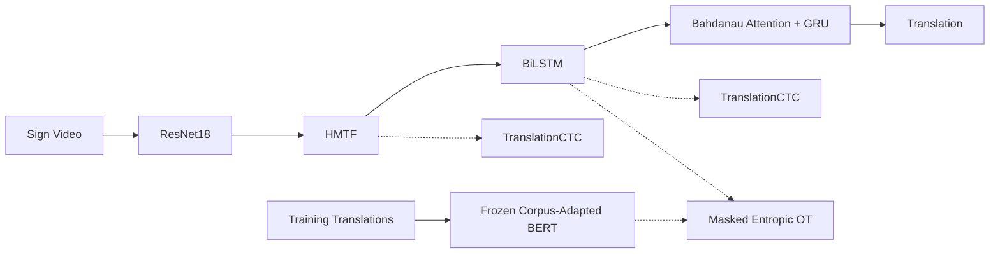

# TransAlign-SLT

### Complementary Temporal and Semantic Supervision for Gloss-Free Sign Language Translation

**Published at the Second Workshop on Sign Language Processing (WSLP 2026), co-located with EMNLP 2026, Budapest, Hungary.**

**Authors:** Pallapu Mohan Krishna · Uppala Sanjay Kumar · M. K. Bhuyan · Debanga Raj Neog

**Affiliation:** Indian Institute of Technology Guwahati, India

**Contact:** [k.pallapu@iitg.ac.in](mailto:k.pallapu@iitg.ac.in) · [Research Website](https://pallapumohankrishna.github.io/)

### 📄 Paper and Resources

[**Paper (ACL Anthology)**](https://aclanthology.org/2026.wslp-1.21/) · [**PDF**](https://aclanthology.org/2026.wslp-1.21.pdf) · [**Project Page**](https://pallapumohankrishna.github.io/projects/transalign-slt/) · [**Publications**](https://pallapumohankrishna.github.io/publications/)

> **Code release status:** The source code is **not publicly available yet**. We are extending this research and plan to release the implementation and reproducibility materials later. This repository currently documents the published paper, proposed framework, and experimental findings. No code release date has been announced.

---

## Overview

**TransAlign-SLT** is a lightweight, **fully gloss-free Sign Language Translation (SLT)** framework trained from paired sign videos and spoken-language translations. It does not require gloss annotations or pseudo-gloss supervision.

Learning from sentence-level translations alone makes it challenging to recover temporal structure and visual–language correspondence.

To address these challenges, TransAlign-SLT combines two complementary training signals:

- **TranslationCTC:** Auxiliary Connectionist Temporal Classification supervision over translation tokens, providing coarse temporal-linguistic regularization.

- **Masked Entropic Optimal Transport (MOT):** Soft semantic correspondence between visual temporal features and contextualized word-level representations from a frozen, corpus-adapted BERT encoder.

Together, these objectives encourage improved temporal organization and semantic alignment without introducing gloss supervision.

The BERT/MOT semantic branch operates **only during training**. The main inference pipeline uses a visual-temporal encoder and a compact attention-based GRU decoder, optionally followed by post-hoc TranslationCTC rescoring of completed hypotheses.

---

## Framework



**Framework interpretation:**

- **Solid arrows** represent the primary inference pathway.
- **Dotted arrows** represent additional training-time supervision.
- BERT and MOT are not required during inference.
- TranslationCTC can optionally rescore completed beam-search hypotheses after autoregressive decoding.

### Method Highlights

**1. Visual-Temporal Modeling**

An ImageNet-initialized ResNet18 extracts visual representations from sign video frames.

Hierarchical Multi-scale Temporal Fusion (HMTF) enhances temporal features, followed by a BiLSTM that captures bidirectional temporal dependencies.

HMTF adapts the temporal feature extraction architecture of GPGN **without initializing from gloss-supervised GPGN weights**.

**2. Temporal Supervision — TranslationCTC**

TranslationCTC provides auxiliary temporal-linguistic supervision using the available translation tokens.

The auxiliary loss coefficient decays from **0.5 to 0.1** during training.

This encourages temporal organization while reducing the auxiliary objective's relative influence later in training.

**3. Semantic Supervision — MOT**

A corpus-adapted, frozen BERT encoder produces contextual text representations.

Subword-to-word pooling constructs word-level semantic features.

Masked Entropic Optimal Transport aligns the visual temporal representations with these word-level features through a soft transport plan.

**4. Translation Decoder**

An attention-based GRU decoder with Bahdanau attention generates spoken-language translations autoregressively.

Optional TranslationCTC-based post-hoc reranking evaluates completed beam-search candidates.

**5. Training Objectives**

The overall framework combines:

- Translation cross-entropy loss
- Auxiliary TranslationCTC loss
- Distillation loss
- Masked Entropic Optimal Transport loss

---

## Main Results

We evaluate TransAlign-SLT on two widely used sign language translation benchmarks.

| Benchmark | Test BLEU-4 ↑ | Test ROUGE-L ↑ |
|:--|--:|--:|
| **PHOENIX14T** | **23.54** | **48.46** |
| **CSL-Daily** | **16.39** | **44.68** |

**Datasets:**

- **PHOENIX14T:** German Sign Language videos from weather forecast broadcasts, paired with German translations.
- **CSL-Daily:** Chinese Sign Language videos covering everyday-life expressions, paired with Chinese translations.

### Model Complexity

| Property | Reported Value |
|:--|--:|
| Inference parameters | **45.6M** |
| Computational cost | **123 GFLOPs** |
| Input resolution | 224 × 224 |
| FLOPs evaluation input | 64 RGB frames |

These figures characterize the reported inference configuration. They should not be interpreted as hardware-matched latency or peak-memory comparisons against other systems.

---

## Component Ablation Studies

The following experiments report **PHOENIX14T development BLEU-4**.

### 1. Temporal Modeling

| Configuration | Dev BLEU-4 ↑ |
|:--|--:|
| TemporalConv + BiLSTM | 18.18 |
| HMTF without BiLSTM | 20.14 |
| **HMTF + BiLSTM** | **22.86** |

The results support combining multi-scale temporal feature extraction with bidirectional sequential modeling.

### 2. Semantic Supervision

| Configuration | Dev BLEU-4 ↑ |
|:--|--:|
| Baseline | 21.54 |
| + BERT/MOT semantic guidance | 21.85 |
| + MLM adaptation | 22.54 |
| **+ Word pooling** | **22.86** |

The results indicate that corpus adaptation and word-level semantic representations contribute to the effectiveness of semantic guidance.

### 3. TranslationCTC Weighting

| Configuration | Dev BLEU-4 ↑ |
|:--|--:|
| Without TranslationCTC | 10.50 |
| Constant weight 0.5 | 22.42 |
| **Decaying weight 0.5 → 0.1** | **22.86** |

TranslationCTC provides an important auxiliary supervisory signal, while the decaying schedule performs better than the evaluated constant-weight configuration.

**Note:** These ablations demonstrate component-level effects but do not constitute a fully controlled factorial study of TranslationCTC–MOT interactions.

---

## Experimental Details

The following settings are reported in the paper.

| Component | Configuration |
|:--|:--|
| Visual backbone | ImageNet-pretrained ResNet18 |
| Temporal encoder | HMTF + BiLSTM |
| Translation decoder | Bahdanau attention + GRU |
| Training sampling | TSN-style temporal segment sampling |
| Inference sampling | Uniformly spaced frames |
| Semantic encoder | Frozen corpus-adapted BERT |
| OT regularization | Entropic regularization, ε = 0.1 |
| Sinkhorn iterations | 50, log-space |
| Distillation temperature | τ = 8 |
| Beam size | 10 |
| Optional CTC reranking coefficient | β_ctc = 0.6 |
| Experimental hardware | NVIDIA RTX A6000 |

**Evaluation protocol:**

- BLEU: NLTK corpus BLEU with smoothing method 3.
- ROUGE-L: Average sentence-level ROUGE-L F1.

For implementation-specific training configurations and additional experimental details, refer to the [published paper](https://aclanthology.org/2026.wslp-1.21/).

Runnable training and inference scripts, complete environment specifications, and model checkpoints are **not included in the repository at present**.

---

## Related Work

Text-level CTC/attention supervision for sign language translation was previously explored by Tan *et al.* in:

[**Improvement in Sign Language Translation Using Text CTC Alignment — COLING 2025**](https://aclanthology.org/2025.coling-main.219/)

TransAlign-SLT builds on the motivation for translation-level temporal supervision by combining a decaying auxiliary TranslationCTC objective with Masked Entropic Optimal Transport for semantic alignment.

This formulation provides complementary temporal and semantic guidance without relying on gloss annotations.

---

## Code Release Roadmap

- [x] Paper accepted at WSLP 2026
- [x] Paper published in the ACL Anthology
- [x] Research overview and architecture documented
- [x] Main benchmark results and ablation studies documented
- [ ] Training and inference code
- [ ] Dependency and environment specifications
- [ ] Dataset preprocessing instructions
- [ ] Training and evaluation configurations
- [ ] Model checkpoints, subject to redistribution permissions
- [ ] Additional reproducibility materials

Updates will be posted in this repository when materials become available.

**Important:** The current repository documents the research and should not yet be treated as a runnable implementation.

---

## Citation

If you find this work useful in your research, please cite our WSLP 2026 paper.

**Publication:**

Pallapu Mohan Krishna, Uppala Sanjay Kumar, M. K. Bhuyan, and Debanga Raj Neog. 2026. *TransAlign-SLT: Complementary Temporal and Semantic Supervision for Gloss-Free Sign Language Translation.* In Proceedings of the Second Workshop on Sign Language Processing, pages 213–223, Budapest, Hungary. Association for Computational Linguistics.

**BibTeX:**

```bibtex
@inproceedings{pallapu2026transalign,
  title     = {{TransAlign-SLT}: Complementary Temporal and Semantic Supervision for Gloss-Free Sign Language Translation},
  author    = {Pallapu, Mohan Krishna and Uppala, Sanjay Kumar and Bhuyan, M. K. and Neog, Debanga Raj},
  booktitle = {Proceedings of the Second Workshop on Sign Language Processing},
  month     = oct,
  year      = {2026},
  address   = {Budapest, Hungary},
  publisher = {Association for Computational Linguistics},
  pages     = {213--223},
  url       = {https://aclanthology.org/2026.wslp-1.21/}
}
```

**Official publication:** https://aclanthology.org/2026.wslp-1.21/

---

## Contact

For research discussions, collaborations, or questions regarding this work:

**Pallapu Mohan Krishna**

PhD Researcher  
Mehta Family School of Data Science and Artificial Intelligence  
Indian Institute of Technology Guwahati, India

- **Email:** [k.pallapu@iitg.ac.in](mailto:k.pallapu@iitg.ac.in)
- **Website:** [pallapumohankrishna.github.io](https://pallapumohankrishna.github.io/)
- **LinkedIn:** [Mohan Krishna Pallapu](https://www.linkedin.com/in/mohan-krishna-pallapu/)
- **Project Page:** [TransAlign-SLT](https://pallapumohankrishna.github.io/projects/transalign-slt/)

---

## License

This repository currently includes an [MIT License](LICENSE).

Third-party assets, future datasets, and model checkpoints may be subject to separate licenses and redistribution restrictions, which will be specified when those resources are released.
