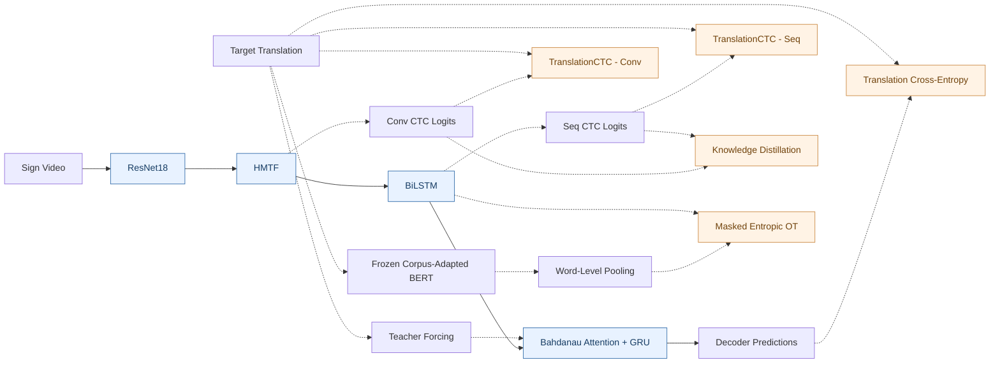

# TransAlign-SLT

### Complementary Temporal and Semantic Supervision for Gloss-Free Sign Language Translation

**Published in the Proceedings of the Second Workshop on Sign Language Processing (WSLP 2026), co-located with EMNLP 2026, Budapest, Hungary.**

**Authors:** Pallapu Mohan Krishna · Uppala Sanjay Kumar · M. K. Bhuyan · Debanga Raj Neog  
**Affiliation:** Indian Institute of Technology Guwahati, India  
**Corresponding author:** [k.pallapu@iitg.ac.in](mailto:k.pallapu@iitg.ac.in)

**Resources:** [Paper (ACL Anthology)](https://aclanthology.org/2026.wslp-1.21/) · [PDF](https://aclanthology.org/2026.wslp-1.21.pdf) · [Project Page](https://pallapumohankrishna.github.io/projects/transalign-slt/) · [Research Website](https://pallapumohankrishna.github.io/)

> **Code availability:** This repository currently documents the published paper and its experimental results. The complete training and inference implementation, configurations, and checkpoints are not publicly released here. Additional materials are planned for release; no release date has been announced.

---

## Overview

**TransAlign-SLT** is a fully gloss-free sign language translation (SLT) framework trained directly from paired sign videos and spoken-language translations, without using gloss or pseudo-gloss supervision.

Learning from sentence-level translations alone makes it challenging to recover temporal structure and visual–language correspondence.

To address these challenges, TransAlign-SLT combines two complementary supervisory signals:

- **TranslationCTC:** Auxiliary CTC supervision over spoken-language translation tokens, providing a coarse temporal-linguistic regularizer.
- **Masked Entropic Optimal Transport (MOT):** Training-time soft semantic alignment between visual temporal features and contextualized word-level representations from a frozen, corpus-adapted BERT encoder.

The framework combines hierarchical multi-scale temporal modeling with bidirectional sequence refinement. An attention-based GRU decoder generates spoken-language translations autoregressively.

The BERT/MOT semantic branch is **training-only**, while TranslationCTC scores can optionally be used for post-hoc reranking of completed beam-search hypotheses during inference.

---

## Architecture

The following diagrams illustrate the training and inference pipelines described in **Figure 1 of the paper**.

### (a) Training Phase



**Training architecture details:**

1. **Visual encoder:** ResNet18 extracts visual features from sign video frames.
2. **Temporal encoder:** HMTF performs hierarchical multi-scale temporal feature extraction, followed by BiLSTM sequence refinement.
3. **TranslationCTC:** Auxiliary CTC objectives are applied to both HMTF and BiLSTM representations using translation tokens. The two branches use a shared classifier.
4. **Knowledge distillation:** Softened predictions from the BiLSTM branch provide teacher supervision to the convolutional branch.
5. **Semantic alignment:** The target translations are encoded using a frozen corpus-adapted BERT model. Word-level representations are aligned with projected BiLSTM visual features using MOT.
6. **Translation decoder:** A single-layer GRU with Bahdanau additive attention is trained with teacher forcing and translation cross-entropy.

Solid arrows represent the main visual translation pathway; dashed arrows represent training-only supervisory connections and auxiliary objectives.

The diagram is a simplified representation of the published architecture. For the complete architecture, see [Figure 1 of the paper](https://aclanthology.org/2026.wslp-1.21.pdf#page=3).

### (b) Inference Phase


**Inference characteristics:**

- The main inference pathway uses ResNet18, HMTF, BiLSTM, and the Bahdanau-attention GRU decoder.
- BERT, MOT, distillation, teacher forcing, and training losses are excluded from the main inference pathway.
- Autoregressive decoding uses beam search.
- TranslationCTC scores are used for optional **post-hoc rescoring of completed hypotheses**.
- CTC scores do not participate in autoregressive beam expansion.

---

## Hierarchical Multi-scale Temporal Fusion (HMTF)

HMTF adapts the **Parallel Densely-Connected Temporal Feature Extraction** architecture of GPGN (Guo et al., 2024) to the sign language translation setting.

The module contains three main stages:

1. **Parallel dilated temporal convolutions:** Extract temporal representations at different receptive fields.
2. **Cross-scale residual fusion:** Exchange information across temporal branches.
3. **Hierarchical fusion:** Combine multi-scale representations into a final temporal feature sequence.

The module uses parallel temporal convolution branches with dilation factors 1, 2, and 3, as illustrated in Figure 2 of the paper.

**Important:** Only the architectural design is adapted from GPGN. TransAlign-SLT does not initialize HMTF using gloss-supervised GPGN checkpoints or gloss-supervised pretrained weights.

See [Figure 2: HMTF Architecture](https://aclanthology.org/2026.wslp-1.21.pdf#page=4).

---

## Complementary Training Objectives

### 1. Auxiliary TranslationCTC

TranslationCTC is applied to both the HMTF and BiLSTM representations.

Unlike conventional gloss-based CTC supervision, the targets are derived directly from the spoken-language translations.

TranslationCTC uses the translation vocabulary, excluding PAD, BOS, and EOS tokens, together with an additional CTC blank class.

The implementation uses PyTorch `CTCLoss` with `zero_infinity=True`.

The TranslationCTC coefficient decreases smoothly from **0.5 to 0.1** during training.

This provides stronger temporal regularization early in optimization while gradually reducing the relative influence of the monotonic CTC objective.

### 2. Knowledge Distillation

Knowledge distillation transfers sequence-level information from the BiLSTM branch to the convolutional branch.

The **BiLSTM branch acts as the teacher**, while the HMTF convolutional branch acts as the student.

The distillation objective uses KL divergence between temperature-scaled branch distributions.

**Distillation temperature:** τ = 8.

### 3. Masked Entropic Optimal Transport (MOT)

MOT encourages soft semantic correspondence between visual features and contextualized word representations.

The semantic alignment process consists of:

1. Adapting a language-specific BERT encoder using masked language modeling on training-set translations.
2. Freezing the adapted BERT encoder during SLT training.
3. Mean-pooling WordPiece subwords belonging to the same lexical word.
4. Projecting BiLSTM visual features into the text embedding space.
5. Computing visual–text transport costs using cosine distance.
6. Applying valid-position masks and entropically regularized optimal transport.

**MOT settings:**

- Entropic regularization: ε = 0.1
- Sinkhorn iterations: 50
- Numerical implementation: Log-space Sinkhorn
- Marginals: Uniform over valid visual and textual positions

MOT does not explicitly enforce monotonic frame-to-word correspondence.

The BERT/MOT branch is used only during training.

### 4. Autoregressive Translation

The translation decoder uses a single-layer GRU with Bahdanau additive attention.

It is conditioned on the BiLSTM temporal representations and trained using teacher forcing with translation cross-entropy.

### Overall Training Objective

The complete training objective, as defined in Equation (13) of the paper, is:

```text
L_total = λ_ctc(e) × (L_CTC_conv + L_CTC_seq)
          + 10 × L_Dist
          +  2 × L_MOT
          +      L_TransCE
```

Where:

- `L_CTC_conv`: TranslationCTC loss from HMTF representations
- `L_CTC_seq`: TranslationCTC loss from BiLSTM representations
- `L_Dist`: Knowledge distillation loss
- `L_MOT`: Masked Entropic Optimal Transport loss
- `L_TransCE`: Autoregressive translation cross-entropy
- `λ_ctc(e)`: Epoch-dependent TranslationCTC coefficient, decaying from 0.5 to 0.1

---

## Experimental Setup

Experiments are conducted on two sign language translation benchmarks.

| Setting | PHOENIX14T | CSL-Daily |
|:--|:--|:--|
| Training samples | 7,096 | 18,401 |
| Development samples | 519 | 1,077 |
| Test samples | 642 | 1,176 |
| Training epochs | 60 | 60 |
| Optimizer | Adam | Adam |
| Learning rate | 1 × 10⁻⁴ | 5 × 10⁻⁵ |
| Weight decay | 1 × 10⁻⁴ | 1 × 10⁻⁶ |
| BERT MLM masking ratio | 0.5 | 0.3 |

### Visual Processing

- **Backbone:** ImageNet-pretrained ResNet18 from torchvision.
- **Training frame sampling:** TSN-style segment sampling, retaining 50% of the original frames.
- **Training augmentation:** Resize to 256 × 256, random crop to 224 × 224, and horizontal flipping.
- **Inference sampling:** Uniformly spaced frames, using the same sampled-frame count, with center cropping.

### Semantic Supervision

- Language-specific BERT encoders
- BERT hidden dimension: 768
- MLM adaptation using only the training translations
- Frozen BERT parameters during SLT training
- WordPiece subword-to-word mean pooling
- MOT with 50 log-space Sinkhorn iterations and ε = 0.1

### Decoding

- Beam search size: 10
- Post-hoc TranslationCTC rescoring coefficient: β_ctc = 0.6

The completed-hypothesis score is:

```text
S_final = (1 - β_ctc) × S_beam + β_ctc × S_CTC
```

The autoregressive beam score uses a length penalty, and the CTC score is normalized by target hypothesis length before interpolation.

CTC scores are applied only to completed beam hypotheses.

### Evaluation

- **BLEU:** NLTK corpus-level BLEU with smoothing method 3.
- **ROUGE-L:** Mean sentence-level F1 based on the longest common subsequence.
- Text is lowercased and punctuation is removed before dictionary encoding.

**Experimental hardware:** NVIDIA RTX A6000 GPU.

---

## Main Results

### Translation Performance

| Benchmark | Dev BLEU-4 ↑ | Dev ROUGE-L ↑ | Test BLEU-4 ↑ | Test ROUGE-L ↑ |
|:--|--:|--:|--:|--:|
| **PHOENIX14T** | 22.86 | 47.63 | **23.54** | **48.46** |
| **CSL-Daily** | 16.17 | 44.13 | **16.39** | **44.68** |

The results are reported in Tables 1 and 2 of the paper.

### Model Complexity

| Property | Reported Value |
|:--|--:|
| Inference parameters | **45.6M** |
| Computational cost | **123 GFLOPs** |
| FLOPs evaluation input | 64 RGB frames |
| Input resolution | 224 × 224 |

These figures describe the reported inference configuration and do not constitute hardware-matched latency, peak-memory, or training-time comparisons.

---

## Ablation Studies

All component-level ablations are performed on the **PHOENIX14T development split**.

### 1. Temporal Modeling (Table 4)

| Temporal Encoder | BLEU-4 ↑ | ROUGE-L ↑ |
|:--|--:|--:|
| TemporalConv + BiLSTM | 18.18 | 43.09 |
| HMTF without BiLSTM | 20.14 | 43.77 |
| **HMTF + BiLSTM** | **22.86** | **47.63** |

The results indicate that multi-scale temporal convolution and bidirectional sequence modeling provide complementary benefits.

### 2. Semantic Supervision (Table 5)

| Configuration | BLEU-4 ↑ | ROUGE-L ↑ |
|:--|--:|--:|
| Baseline without BERT/MOT | 21.54 | 45.10 |
| + BERT representations with MOT | 21.85 | 45.95 |
| + MLM corpus adaptation | 22.54 | 46.90 |
| **+ Word-level subword pooling** | **22.86** | **47.63** |

The configurations are cumulative.

Corpus-adapted contextual representations and word-level pooling improve the usefulness of semantic alignment.

### 3. TranslationCTC Weighting (Table 6)

| TranslationCTC Strategy | BLEU-4 ↑ | ROUGE-L ↑ |
|:--|--:|--:|
| Constant λ = 0.0 | 10.50 | 27.01 |
| Constant λ = 0.6 | 21.50 | 47.20 |
| Constant λ = 0.5 | 22.42 | 47.46 |
| Constant λ = 0.4 | 22.40 | 47.70 |
| **Decay 0.5 → 0.1** | **22.86** | **47.63** |

The decaying schedule achieves the highest BLEU-4 among these configurations.

These findings support the usefulness of TranslationCTC as an early temporal-linguistic optimization prior.

### 4. Decoding Strategy (Table 7)

| Decoding Strategy | BLEU-4 ↑ | ROUGE-L ↑ |
|:--|--:|--:|
| Greedy decoding | 20.58 | 45.44 |
| Greedy + CTC rescoring | 20.60 | 45.60 |
| Beam search | 22.40 | 46.54 |
| **Beam search + CTC rescoring** | **22.86** | **47.63** |

Beam search accounts for most of the decoding improvement, while post-hoc TranslationCTC rescoring provides a smaller additional gain.

### 5. Decoder Choice

The paper also evaluates an mBART-based decoder variant.

| Decoder | PHOENIX14T Dev BLEU-4 ↑ |
|:--|--:|
| mBART-based decoder variant | 20.43 |
| **GRU + Bahdanau attention** | **22.86** |

These results indicate that increasing the decoder scale alone does not explain the observed improvements under the evaluated configurations.

---

## Qualitative Findings

The qualitative analysis in Table 3 highlights both successful semantic preservation and remaining translation errors.

The model can preserve much of the sentence-level weather context while occasionally failing to distinguish fine-grained lexical or numerical details.

Representative errors include:

- Confusing *snow* with *sleet*.
- Replacing *fifth* with *tenth* in a date expression.

These examples suggest that broad semantic context can be retained even when fine-grained lexical accuracy remains challenging.

---

## Limitations

- Evaluation is restricted to PHOENIX14T and CSL-Daily.
- Generalization to other sign languages and domains has not been established.
- Hardware-matched inference latency, peak-memory, and training-time comparisons are not reported.
- The reported ablations are component-level analyses rather than a fully controlled factorial study of TranslationCTC–MOT interactions.

---

## Code Release Roadmap

- [x] Paper published at WSLP 2026
- [x] Research overview and architecture documented
- [x] Benchmark results documented
- [x] Component ablation studies documented
- [ ] Training and inference implementation
- [ ] Dependencies and environment specifications
- [ ] Dataset preprocessing instructions
- [ ] Training and evaluation configurations
- [ ] Model checkpoints, subject to redistribution permissions
- [ ] Additional reproducibility materials

**Note:** This repository currently serves as research documentation and should not be treated as a runnable implementation.

---

## Citation

If you find this work useful, please cite our WSLP 2026 paper:

**Pallapu Mohan Krishna, Uppala Sanjay Kumar, M. K. Bhuyan, and Debanga Raj Neog.** 2026. *TransAlign-SLT: Complementary Temporal and Semantic Supervision for Gloss-Free Sign Language Translation.* In Proceedings of the Second Workshop on Sign Language Processing, pages 213–223, Budapest, Hungary. Association for Computational Linguistics.

```bibtex
@inproceedings{pallapu2026transalign,
  title     = {{TransAlign-SLT}: Complementary Temporal and Semantic Supervision for Gloss-Free Sign Language Translation},
  author    = {Pallapu, Mohan Krishna and Uppala, Sanjay Kumar and Bhuyan, M. K. and Neog, Debanga Raj},
  booktitle = {Proceedings of the Second Workshop on Sign Language Processing},
  month     = oct,
  year      = {2026},
  address   = {Budapest, Hungary},
  publisher = {Association for Computational Linguistics},
  pages     = {213--223},
  url       = {https://aclanthology.org/2026.wslp-1.21/}
}
```

**Official publication:** https://aclanthology.org/2026.wslp-1.21/

---

## Contact

**Pallapu Mohan Krishna**  
PhD Researcher  
Mehta Family School of Data Science and Artificial Intelligence  
Indian Institute of Technology Guwahati, India

- **Email:** [k.pallapu@iitg.ac.in](mailto:k.pallapu@iitg.ac.in)
- **Website:** [pallapumohankrishna.github.io](https://pallapumohankrishna.github.io/)
- **LinkedIn:** [Mohan Krishna Pallapu](https://www.linkedin.com/in/mohan-krishna-pallapu/)
- **Project Page:** [TransAlign-SLT](https://pallapumohankrishna.github.io/projects/transalign-slt/)

---

## License

This repository currently includes an [MIT License](LICENSE).

Third-party assets, datasets, and future model checkpoints may be subject to separate licensing and redistribution restrictions.
